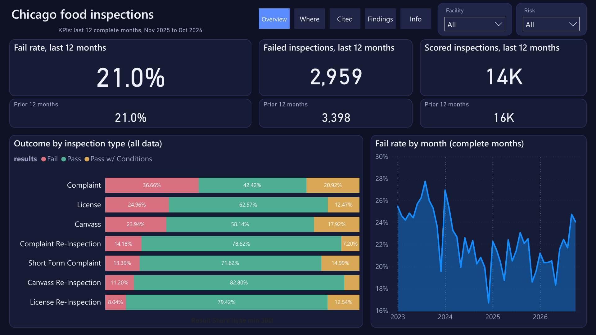
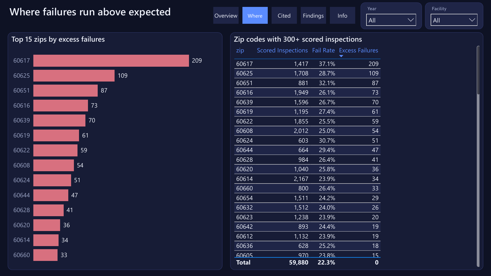
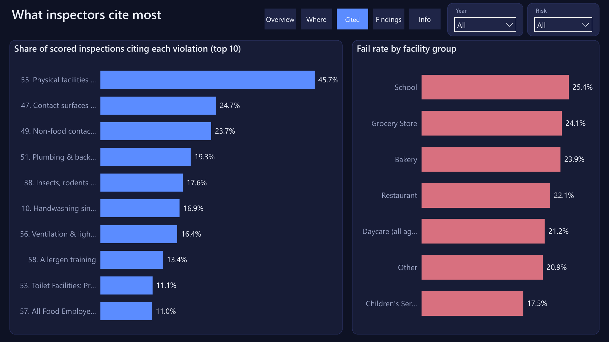
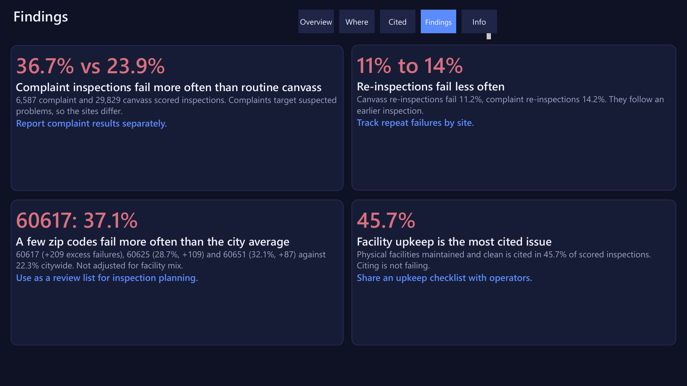
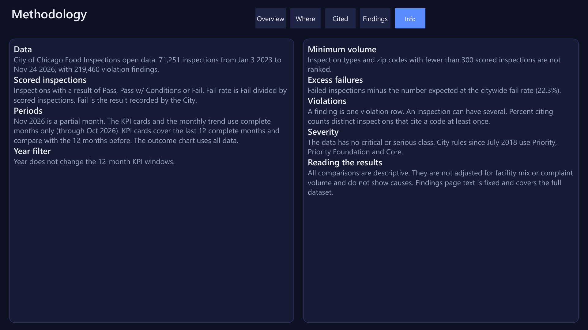

# Chicago Food Inspections: Power BI Project

A 5-page Power BI report on Chicago food inspection results. It looks at how often inspections fail, where failures run above the city average, and which violations are cited most.

**Data:** [City of Chicago Food Inspections](https://data.cityofchicago.org/Health-Human-Services/Food-Inspections/4ijn-s7e5) (open data). 71,251 inspections and 219,460 violation findings, Jan 3 2023 to Nov 24 2026.

## Pages

| Page | Question |
|---|---|
| Overview | How often do inspections fail, and is that changing? |
| Where | Which zip codes fail more often than the city average? |
| Cited | Which violations show up most? |
| Findings | What do the numbers say in practice? |
| Info | Definitions, periods and limits |

## Main results

- Last 12 complete months (Nov 2025 to Oct 2026): 2,959 failed of 14,083 scored inspections, a 21.0% fail rate. The 12 months before: 3,398 of 16,208, also 21.0%.
- Over the whole period: 13,354 failed of 59,880 scored, 22.3%.
- Complaint inspections fail 36.7% of the time, routine canvass 23.9%. Complaints target suspected problems, so the two are not like for like.
- Code 55 (physical facilities maintained and clean) is cited in 45.7% of scored inspections. A citation is not a fail.
- Zip 60617 fails 37.1% of 1,417 scored inspections, about 209 more failures than the city rate would predict. This is a review signal, not a verdict on the area.

## What is in the model

- Tables: Inspections, Violations, and a date table. Inspections link to Violations by inspection ID and to the date table by inspection date.
- DAX measures for fail rate, failed and scored counts, last 12 complete months vs the 12 months before, and complete-month trends.
- Facility types are grouped into short labels (`facility_group`). The City's original name stays in `facility_group_source`.

## Definitions and limits

- Scored inspection: result is Pass, Pass w/ Conditions or Fail. Fail rate = Fail / scored. Fail is the result recorded by the City.
- Nov 2026 is a partial month, so it is left out of the trend and the 12-month cards.
- Findings are violation rows. One inspection can have several.
- Zips and inspection types need 300+ scored inspections to be ranked.
- Comparisons are descriptive. They are not adjusted for facility mix and do not show causes.

## Open it

1. Download this repo. Extract `ChicagoFoodSafety-project.zip` and `data.zip` (the two CSV files) into folders on your machine. A short folder path avoids problems.
2. Open `ChicagoFoodSafety/ChicagoFoodSafety.pbip` in a current Power BI Desktop.
3. The `DataFolder` parameter is set to `D:\My Portfolio\ChicagoFoodSafety\data` (the author's machine). Under Transform data, edit it to the full path of your `data` folder, then Refresh.

Project format: [Power BI Desktop projects](https://learn.microsoft.com/en-us/power-bi/developer/projects/projects-overview).
